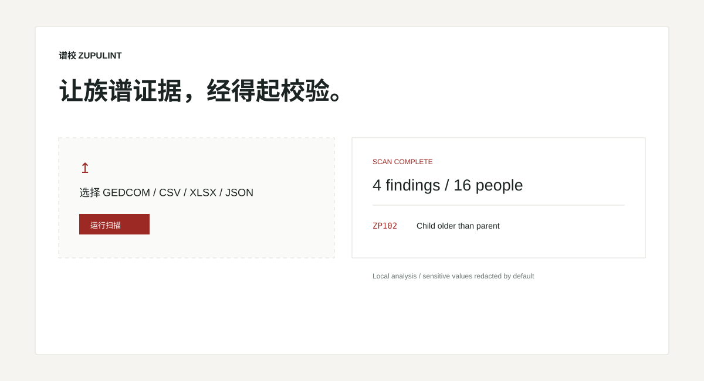

# ZupuLint · 谱校

[简体中文](README.zh-CN.md)

[](https://github.com/KanadeK/zupulint/actions/workflows/ci.yml)
[](LICENSE)

ZupuLint is a privacy-first, local genealogy data linter. It really parses GEDCOM, CSV, Excel (`.xlsx`), and JSON into one canonical model, then runs 26 deterministic checks for structure, chronology, generations and Chinese generation characters, succession, possible duplicate people, privacy, and data quality.



## What it does

- One Python rule engine powers the library, Typer CLI, FastAPI API, and React/Vite workbench.
- GEDCOM is read as a level-aware tree. CSV, XLSX, and JSON are decoded, mapped, and validated instead of returning embedded demo results.
- Every finding has a stable rule ID, severity, evidence, confidence, and a repair suggestion.
- Reports are self-contained offline HTML, structured JSON, or SARIF 2.1.0.
- Source files are never mutated and possible duplicates are never merged automatically.

## Install

Download the wheel from the [v0.1.0 release](https://github.com/KanadeK/zupulint/releases/tag/v0.1.0), then install it in an isolated environment:

```bash
pipx install ./zupulint-0.1.0-py3-none-any.whl
# or
uv tool install ./zupulint-0.1.0-py3-none-any.whl
```

For development from a checkout:

```bash
uv sync --all-extras --dev
uv run zupulint version
```

Python 3.12 or newer is required. Standalone Windows, Linux, and macOS archives are attached to each release and do not require a Python installation.

## Real usage

Create synthetic input, scan it, and open the resulting offline report:

```bash
zupulint sample create --destination zupulint-sample
zupulint scan zupulint-sample/valid/family.ged \
  --format html --output report.html --fail-on error
zupulint scan family.csv --delimiter ';' --encoding gb18030 \
  --column-map column-map.json --format sarif --output report.sarif
zupulint validate family.xlsx --sheet People
zupulint rules describe ZP203
```

`scan` supports `--config`, `--format text|html|json|sarif`, `--output`, `--fail-on info|warning|error`, `--locale`, `--no-redact`, `--sheet`, `--encoding`, `--delimiter`, `--column-map`, `--quiet`, and `--verbose`. Exit code `0` means no finding met the threshold, `1` means findings met it, and `2` means the input, configuration, or runtime failed.

## Local web workbench and API

The installed package contains the built React UI:

```bash
zupulint web
# open http://127.0.0.1:8000
```

Choose a file, preview bounded rows, select an XLSX sheet or CSV mapping, scan, filter findings, inspect evidence, and download HTML/JSON/SARIF. The same local process exposes OpenAPI at `http://127.0.0.1:8000/docs`. Files are not persisted between requests or page reloads.

Frontend development uses two local processes:

```bash
uv run zupulint web
pnpm --dir apps/web dev
```

## Docker

```bash
docker build -t zupulint:local .
docker run --rm -p 127.0.0.1:8000:8000 \
  --read-only --tmpfs /tmp --cap-drop ALL \
  --security-opt no-new-privileges zupulint:local
curl -f http://127.0.0.1:8000/health
```

The image runs as an unprivileged user and includes a health check. `docker compose up --build` applies the same read-only and capability restrictions.

## Supported formats

| Format | Implemented scope |
|---|---|
| GEDCOM | Level-aware GEDCOM 5.5.1/7 subset; pointers, families, sources, events, `CONT`/`CONC`, unknown extensions, UTF-8/BOM and GB18030 |
| CSV | Quoted header table, configurable delimiter/encoding and column mapping, canonical people and relationship columns |
| XLSX | Explicit sheet selection, typed dates, merged-cell warnings, formula-like values kept inert, column mapping |
| JSON | Canonical people, relationships, events, sources, metadata and forward-compatible extension fields, validated by the published schema |

Input, configuration, and report contracts live in [`schemas/`](schemas/). See the complete [format guide](docs/formats.md).

## Rules

The v0.1.0 inventory is exactly 26 rules:

| Family | IDs | Purpose |
|---|---|---|
| Structure | ZP001–ZP006 | Duplicate IDs, missing/self references, ancestry cycles, duplicate and conflicting relationships |
| Chronology | ZP101–ZP105 | Birth/death ordering, parent age, marriage timing, lifespan |
| Generation | ZP201–ZP204 | Parent/child and sibling generations, generation characters, branch poems |
| Adoption and succession | ZP301–ZP304 | Biological/successor overlap, chu-si/cheng-si direction, inheritance identity, jian-tiao completeness |
| Possible duplicate | ZP401 | Weighted identity evidence; review only, never auto-merge |
| Privacy | ZP501–ZP503 | Living-person sensitive fields, unsafe output settings, public/high-sensitivity conflicts |
| Data quality | ZP601–ZP603 | Required fields, unparsed dates, optional source requirements |

The [rule reference](docs/rules.md) documents every rule's definition, exact detection logic, example, false-positive boundary, configuration, and repair guidance.

## Report example

```json
{
  "version": "0.1.0",
  "summary": {
    "people": 16,
    "relationships": 24,
    "issues": 0,
    "by_severity": {},
    "by_rule": {}
  },
  "issues": []
}
```

Reproducible HTML and JSON examples are checked in under [`examples/expected-reports/`](examples/expected-reports/). HTML is self-contained and works without a network connection.

## Privacy and security

Analysis is local; ZupuLint has no telemetry, cloud upload, or third-party AI call. The API limits input to 20 MiB and configuration to 256 KiB, accepts only documented extensions, deletes request-scoped temporary files, does not log file contents, escapes report values, and returns restrictive browser headers. Living-person redaction is enabled by default. Synthetic fixtures contain no real genealogy data.

Read the [privacy model](docs/privacy.md) before relaxing redaction or exposing reports.

## Development and acceptance

```bash
make bootstrap
make lint
make format-check
make typecheck
make test
make test-frontend
make test-e2e
make build
make package
make docs
make docker-build
make security
make verify
```

Equivalent commands without Make:

```bash
uv lock --check
uv sync --frozen --all-extras --dev
corepack pnpm install --frozen-lockfile
uv run ruff format --check src tests scripts
uv run ruff check src tests scripts
uv run mypy src scripts tests
uv run pytest
uv run python scripts/check_coverage.py
corepack pnpm --dir apps/web format:check
corepack pnpm --dir apps/web lint
corepack pnpm --dir apps/web typecheck
corepack pnpm --dir apps/web test:coverage
corepack pnpm --dir apps/web build
uv run python scripts/sync_web_assets.py
uv build
corepack pnpm --dir apps/web exec playwright install --with-deps chromium
corepack pnpm --dir apps/web e2e
uv run python scripts/package_release.py
uv run mkdocs build --strict
docker build -t zupulint:local .
uv run pip-audit --skip-editable
corepack pnpm --dir apps/web audit --prod --registry=https://registry.npmjs.org --audit-level high
uv run python scripts/secret_scan.py
uv run python scripts/verify_release.py
uv run python scripts/smoke_test.py
git diff --check
git status --short
```

## Known limitations and roadmap

- GEDCOM support is a documented 5.5.1/7 subset, not every vendor extension.
- Very large files are deliberately rejected: 20 MiB input, 100,000 tabular rows, 512 columns, 64 JSON nesting levels, and 100 MiB expanded XLSX data.
- Chinese generation-character inference cannot know every branch convention and may report lower-confidence review items.
- Duplicate scoring is deterministic candidate detection, not identity proof.
- Repair guidance never rewrites the original dataset in v0.1.0.

See [ROADMAP.md](ROADMAP.md) for planned GEDCOM 7 coverage, non-mutating repair plans, and additional regional conventions.

## Project links

- Documentation and example report: <https://kanadek.github.io/zupulint/>
- v0.1.0 release and checksums: <https://github.com/KanadeK/zupulint/releases/tag/v0.1.0>
- Contributing: [CONTRIBUTING.md](CONTRIBUTING.md)
- Security policy: [SECURITY.md](SECURITY.md)
- Citation metadata: [CITATION.cff](CITATION.cff)
- License: [Apache-2.0](LICENSE)
