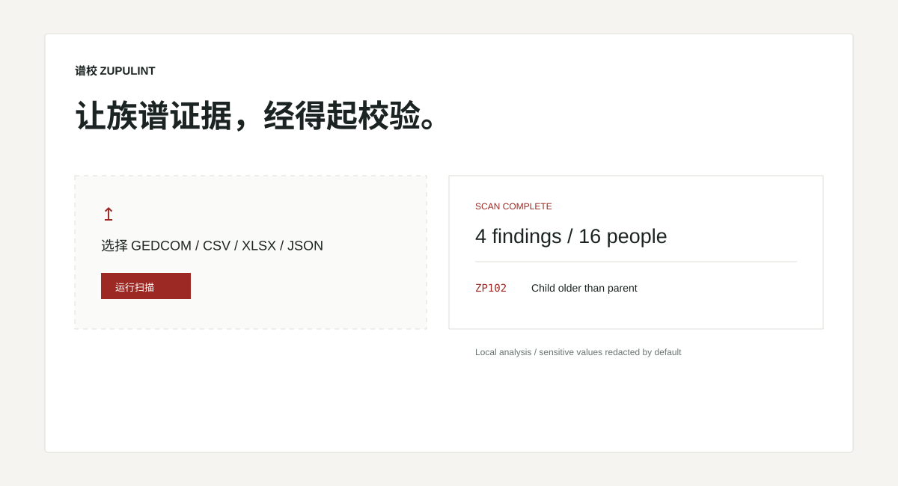

# ZupuLint · 谱校

[English](README.md)

[](https://github.com/KanadeK/zupulint/actions/workflows/ci.yml)
[](LICENSE)

谱校是一款隐私优先、默认本地运行的族谱数据校核工具。它会真实解析 GEDCOM、CSV、Excel（`.xlsx`）和 JSON，转换为统一模型，再执行 26 条确定性规则，覆盖结构、年代、世代与字辈、收养继嗣、疑似重复人物、隐私和数据质量。



## 能做什么

- Python 库、Typer CLI、FastAPI API 和 React/Vite 工作台共用同一规则引擎。
- GEDCOM 按层级树解析；CSV、XLSX、JSON 会真实解码、映射和校验，不返回内置演示结果。
- 每条问题都带稳定规则 ID、严重级别、证据、置信度和修复建议。
- 可导出完全离线的 HTML、结构化 JSON 和 SARIF 2.1.0 报告。
- 永不修改源文件，也不会自动合并疑似重复人物。

## 安装

从 [v0.1.0 Release](https://github.com/KanadeK/zupulint/releases/tag/v0.1.0) 下载 wheel，然后隔离安装：

```bash
pipx install ./zupulint-0.1.0-py3-none-any.whl
# 或
uv tool install ./zupulint-0.1.0-py3-none-any.whl
```

从源码开发：

```bash
uv sync --all-extras --dev
uv run zupulint version
```

Python 版本要求为 3.12 或更高。Release 还提供 Windows、Linux、macOS 独立压缩包，不要求预装 Python。

## 真实使用示例

```bash
zupulint sample create --destination zupulint-sample
zupulint scan zupulint-sample/valid/family.ged \
  --format html --output report.html --fail-on error
zupulint scan family.csv --delimiter ';' --encoding gb18030 \
  --column-map column-map.json --format sarif --output report.sarif
zupulint validate family.xlsx --sheet People
zupulint rules describe ZP203
```

`scan` 支持 `--config`、`--format text|html|json|sarif`、`--output`、`--fail-on info|warning|error`、`--locale`、`--no-redact`、`--sheet`、`--encoding`、`--delimiter`、`--column-map`、`--quiet`、`--verbose`。退出码 `0` 表示没有达到阈值的问题，`1` 表示存在达到阈值的问题，`2` 表示输入、配置或运行失败。

## 本地网页工作台与 API

安装包已包含构建后的 React 页面：

```bash
zupulint web
# 打开 http://127.0.0.1:8000
```

可选择文件、查看有上限的导入预览、选择 XLSX 工作表或 CSV 列映射、执行扫描、筛选问题、展开证据并下载 HTML/JSON/SARIF。本地进程同时在 `http://127.0.0.1:8000/docs` 提供 OpenAPI。文件不会跨请求或刷新持久保存。

前端开发需要两个本地进程：

```bash
uv run zupulint web
pnpm --dir apps/web dev
```

## Docker

```bash
docker build -t zupulint:local .
docker run --rm -p 127.0.0.1:8000:8000 \
  --read-only --tmpfs /tmp --cap-drop ALL \
  --security-opt no-new-privileges zupulint:local
curl -f http://127.0.0.1:8000/health
```

镜像使用非特权用户并带健康检查；`docker compose up --build` 会应用相同的只读文件系统和能力限制。

## 支持格式

| 格式 | 已实现范围 |
|---|---|
| GEDCOM | 层级式 GEDCOM 5.5.1/7 子集；指针、家庭、来源、事件、`CONT`/`CONC`、未知扩展、UTF-8/BOM 与 GB18030 |
| CSV | 带引号的表头表格；可配置分隔符、编码和列映射；人物及关系列 |
| XLSX | 明确选择工作表；日期单元格、合并单元格警告、公式形态文本惰性导入、列映射 |
| JSON | 人物、关系、事件、来源、元数据及可扩展字段，并按公开 Schema 校验 |

输入、配置和报告契约位于 [`schemas/`](schemas/)，完整说明见[格式文档](docs/formats.md)。

## 规则

v0.1.0 恰好实现 26 条规则：

| 规则族 | ID | 用途 |
|---|---|---|
| 结构 | ZP001–ZP006 | 重复 ID、引用缺失、自我关系、血缘环、重复关系和角色冲突 |
| 年代 | ZP101–ZP105 | 生卒顺序、生育年龄、婚姻时间和寿命 |
| 世代 | ZP201–ZP204 | 父子/同胞世代、字辈字符和房支字辈表 |
| 收养继嗣 | ZP301–ZP304 | 生父/嗣父重叠、出嗣承嗣方向、继承身份、兼祧完整性 |
| 疑似重复 | ZP401 | 多证据加权候选；只供复核，绝不自动合并 |
| 隐私 | ZP501–ZP503 | 在世敏感字段、不安全输出设置、公开记录与高敏信息冲突 |
| 数据质量 | ZP601–ZP603 | 必要字段、未解析日期、可选来源要求 |

[规则手册](docs/rules.md)逐条说明问题定义、检测逻辑、示例、误报可能、配置方式和修复建议。

## 报告示例

```json
{
  "version": "0.1.0",
  "summary": {
    "people": 16,
    "relationships": 24,
    "issues": 0,
    "by_severity": {},
    "by_rule": {}
  },
  "issues": []
}
```

可复现的 HTML/JSON 报告保存在 [`examples/expected-reports/`](examples/expected-reports/)。HTML 为自包含文件，断网也可打开。

## 隐私与安全

所有分析默认在本机完成；没有遥测、云端上传或第三方 AI 调用。API 输入上限 20 MiB、配置上限 256 KiB，只接受文档列出的扩展名；请求级临时文件会自动删除，不记录文件内容，报告值经过转义，并返回限制性浏览器安全头。在世成员默认脱敏，仓库样例均为合成数据。

放宽脱敏或公开报告前请阅读[隐私模型](docs/privacy.md)。

## 开发与验收

```bash
make bootstrap
make lint
make format-check
make typecheck
make test
make test-frontend
make test-e2e
make build
make package
make docs
make docker-build
make security
make verify
```

不使用 Make 的等价命令：

```bash
uv lock --check
uv sync --frozen --all-extras --dev
corepack pnpm install --frozen-lockfile
uv run ruff format --check src tests scripts
uv run ruff check src tests scripts
uv run mypy src scripts tests
uv run pytest
uv run python scripts/check_coverage.py
corepack pnpm --dir apps/web format:check
corepack pnpm --dir apps/web lint
corepack pnpm --dir apps/web typecheck
corepack pnpm --dir apps/web test:coverage
corepack pnpm --dir apps/web build
uv run python scripts/sync_web_assets.py
uv build
corepack pnpm --dir apps/web exec playwright install --with-deps chromium
corepack pnpm --dir apps/web e2e
uv run python scripts/package_release.py
uv run mkdocs build --strict
docker build -t zupulint:local .
uv run pip-audit --skip-editable
corepack pnpm --dir apps/web audit --prod --registry=https://registry.npmjs.org --audit-level high
uv run python scripts/secret_scan.py
uv run python scripts/verify_release.py
uv run python scripts/smoke_test.py
git diff --check
git status --short
```

## 已知限制与路线图

- GEDCOM 是文档化的 5.5.1/7 子集，不覆盖所有厂商扩展。
- 超大文件会被主动拒绝：输入 20 MiB、表格 100,000 行/512 列、JSON 嵌套 64 层、XLSX 解压后 100 MiB。
- 中文字辈推断无法理解所有房支惯例，可能给出较低置信度的复核项。
- 重复评分只是确定性的候选检测，不是身份结论。
- v0.1.0 的修复建议不会改写原始数据。

后续 GEDCOM 7 覆盖、非破坏式修复计划和更多地域族谱惯例见 [ROADMAP.md](ROADMAP.md)。

## 项目链接

- 文档与示例报告：<https://kanadek.github.io/zupulint/>
- v0.1.0 Release 与校验和：<https://github.com/KanadeK/zupulint/releases/tag/v0.1.0>
- 贡献指南：[CONTRIBUTING.md](CONTRIBUTING.md)
- 安全策略：[SECURITY.md](SECURITY.md)
- 引用信息：[CITATION.cff](CITATION.cff)
- 协议：[Apache-2.0](LICENSE)
