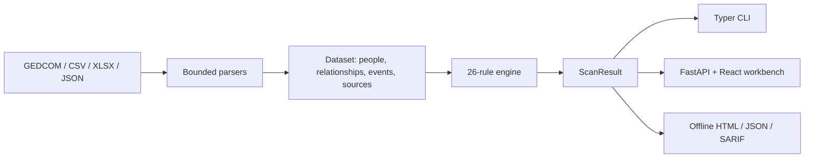

# Architecture

ZupuLint has one canonical data and rule path. Interfaces do not implement shadow parsers or embedded demo findings.

## Python core

- `models/`: extensible Pydantic models and stable relationship enums.
- `normalizers/`: exact, partial, qualified, range, and retained-unparsed genealogy dates.
- `parsers/inputs.py`: size/depth/line-bounded decoders and normalization.
- `config/`: recursive default merge and strict Pydantic configuration validation.
- `privacy/`: living-person inference and sensitive-field category detection.
- `rules/`: immutable rule definitions, validators, stable ordering, and `ScanResult`.
- `reports/render.py`: Jinja2-autoescaped offline HTML plus JSON and SARIF serializers.

`rules.scan` is the only rule execution path. Compatibility imports at `zupulint.engine` and `zupulint.dates` delegate to the same implementation. The CLI and API provide input metadata and configuration, then serialize the returned result.

## API and web assets

`api/app.py` handles bounded multipart uploads inside request-scoped temporary directories. The Vite output is synchronized into `src/zupulint/web_assets` before package builds and included in the wheel and PyInstaller executable. FastAPI serves `/assets` and client-side routes only when those assets exist.

The React application uses TanStack Query for preview, scan, and report mutations and React Router for workbench/privacy routes. It holds the selected file only in browser memory and clears it on request.

## Contracts and deterministic evidence

JSON Schemas define input, configuration, and report contracts. Checked-in synthetic fixtures have fixed scan times and expected JSON/HTML outputs. Sorting is explicit, generated XLSX/ZIP timestamps are fixed, release artifacts carry SHA-256 checksums, and a CycloneDX SBOM records dependencies.

## Deployment boundaries

- GitHub Pages contains static documentation and a synthetic report, not a scanner.
- The Docker image and local CLI server run the actual API/UI.
- CI never commits generated artifacts back to `main`.
- Release jobs verify the tag points to `main`, rebuild, smoke-test each platform binary, and publish assets only after the core gate passes.
