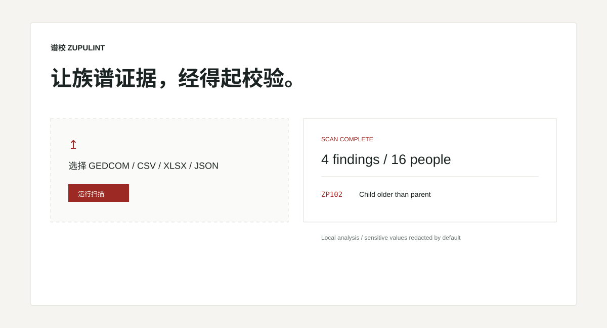

# ZupuLint · 谱校

ZupuLint is a privacy-first, local linter for genealogy data. It converts GEDCOM, CSV, XLSX, and JSON into one canonical model, then runs 26 deterministic checks covering structure, chronology, generations and Chinese generation characters, succession, possible duplicate people, privacy, and data quality.

The Python library, CLI, REST API, and React workbench all call the same parser and rule engine. Reports can be self-contained HTML, JSON, or SARIF 2.1.0, and no workflow mutates the original family data.

## Start here

1. Follow [Getting started](getting-started.md) to install the release wheel or run from source.
2. Check [Formats](formats.md) and [Configuration](configuration.md) before importing a non-standard table.
3. Use the [Rule reference](rules.md) to interpret a finding and its confidence.
4. Read [Privacy](privacy.md) before sharing any report.

The Pages site hosts documentation, schemas, the project screenshot, and a synthetic example report. It is not an online scanning service; scanning happens only through your local CLI, API, or workbench.

- [Synthetic example report](https://kanadek.github.io/zupulint/examples/)
- [Input schema](https://kanadek.github.io/zupulint/schemas/zupulint-input.schema.json)
- [Configuration schema](https://kanadek.github.io/zupulint/schemas/zupulint-config.schema.json)
- [Report schema](https://kanadek.github.io/zupulint/schemas/zupulint-report.schema.json)
